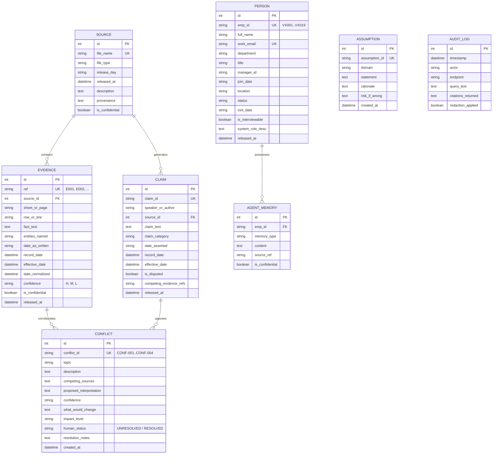

# Veloxa CXO Cockpit — Architecture & System Design
**Assessment Phase:** Individual Hackathon (Day 1 Release — Mon 16 Nov 2026 10:00 IST)  
**Author / Candidate:** Rivu Chattopadhyay  
**Repository:** https://github.com/rivu851/veloxa-cockpit-rivu-chattopadhyay  
**Submission Milestone:** Monday 16 Nov 2026 by 23:59 IST  

---

## 1. System Overview & Core Tenets

The **Veloxa CXO Cockpit** is an executive decision support and governance platform built for the Chief Executive Officer and leadership team of Veloxa Technologies. It synthesizes disparate, contradictory operational records—board decks, general ledgers, HRMS exports, payroll records, email correspondence, and automated meeting transcripts—into a verifiable, zero-hallucination decision engine.

### Core Architectural Tenets
1. **Deterministic Grounding & Zero-Hallucination:** Every factual answer returned by the Cockpit is backed by one or more immutable evidence citations (`E001`, `E002`, ...). The system refuses to answer queries that lack primary source backing.
2. **Strict Salary Privacy Enforcement:** Individual employee compensation data is protected at the API and service layer per CFO Meera Iyer's governance directive (`T2_CFO_Call`). Individual salaries are never disclosed in executive queries; only aggregated company-wide payroll totals are accessible.
3. **Temporal Partitioning & As-Of Consistency:** Facts distinguish three temporal dimensions:
   - `released_at`: Timestamp when the source file was made accessible in the hackathon data room.
   - `record_date`: Date when the document or record was created or transmitted.
   - `effective_date`: Date when the underlying business event occurred or financial period ended.
   Future release material (Day 2, Day 3, Day 4) cannot leak into historical queries.
4. **Human-in-the-Loop Conflict Governance:** Factual discrepancies between executive verbal statements and formal board decks are cataloged as unresolved conflicting claims, without ungrounded speculation. Decisions remain `UNRESOLVED` pending explicit human confirmation.
5. **Interviewable Grounded AI Agents:** 14+ AI employee personas are grounded strictly in organizational records (`Employee_Master.xlsx`), operating within verified knowledge boundaries.

---

## 2. High-Level Architecture Diagram

```mermaid
flowchart TD
    subgraph DataRoom ["Data Room Sources (Day 1 Release)"]
        D1["Employee_Master.xlsx (Keka HRMS)"]
        D2["GL_Export_Apr-Sep_2026.xlsx (Zoho Books)"]
        D3["Payroll_Register_Jan-Mar_2026.xlsx"]
        D4["Board Updates (Q1 & Q2 FY27)"]
        D5["Emails (01.eml, 02.eml, 03.eml)"]
        D6["Transcripts (T1 CEO Call, T2 CFO Call)"]
    end

    subgraph Ingestion ["Deterministic Ingestion & Normalization"]
        Parser["Deterministic Ingest Engine (ingest.py)"]
        PrivacyMask["Service-Layer Privacy Redactor (privacy.py)"]
    end

    subgraph Storage ["SQLite Relational Storage"]
        T_Source["sources"]
        T_Evidence["evidence (E001..E027+)"]
        T_Claim["claims"]
        T_Person["people (VX001..VX019)"]
        T_Conflict["conflicts (CONF-001..CONF-004)"]
        T_Assumption["assumptions"]
        T_Memory["agent_memories"]
        T_Audit["audit_logs"]
    end

    subgraph ServiceLayer ["FastAPI Core Services (backend/app)"]
        QueryEngine["Query & Retrieval Engine (query_engine.py)"]
        TemporalFilter["Temporal 'As-Of' Filter"]
        AgentEngine["Grounded Agent Engine"]
        PrivacyEnforcer["Salary Privacy Enforcer"]
    end

    subgraph Presentation ["Next.js App Router (frontend/src)"]
        UI_Query["CEO Decision Query & Answer View"]
        UI_Evidence["Collapsible Evidence Drawer"]
        UI_Risks["Ranked Evidence-Backed Risks"]
        UI_Agents["14+ Grounded Employee Agents"]
        UI_Conflicts["Source Conflict & Human Review Table"]
    end

    DataRoom --> Parser
    Parser --> PrivacyMask
    PrivacyMask --> Storage
    Storage --> ServiceLayer
    ServiceLayer --> Presentation
```



---

## 3. Relational Database Schema

The persistence layer uses SQLite with SQLAlchemy ORM, implementing a normalized schema designed for temporal provenance, conflict tracking, and privacy protection.



---

## 4. Privacy & Redaction Architecture

### Policy Requirement
In `T2_CFO_Call.docx`, CFO Meera Iyer mandates:
> *"Individual salaries must never show up in anything Ananya sees, only totals."*

### Multi-Layer Enforcement
1. **Public vs Private Seed Separation:**
   - Raw confidential payroll records are excluded from public Git tracking via `.gitignore`.
   - Seed fixtures store sanitized metadata while masking granular employee gross, net, and deduction amounts.
2. **Service-Layer Privacy Interceptor (`backend/app/services/privacy.py`):**
   - Intercepts both direct salary queries (*"What is Vikram's salary?"*, *"How much does Rahul earn?"*) and indirect inference attempts (*"Who is the highest paid person?"*, *"What is the average engineering salary?"*, *"Rank employees by compensation"*).
   - Returns an immediate `REFUSAL`:
     ```json
     {
       "status": "REFUSAL",
       "answer": "REFUSAL: Policy restriction. Individual employee compensation details are confidential and restricted from executive cockpit queries per CFO governance directive (T2_CFO_Call). Only aggregated company-wide payroll totals may be reported.",
       "citations": [{"ref": "E027", "source_file": "T2_CFO_Call.docx"}]
     }
     ```
3. **Evidence Redaction:**
   - At `/api/evidence/{ref}`, any payroll register entry containing gross, net, or deduction amounts dynamically masks those numbers as `[REDACTED_CONFIDENTIAL]`.
4. **Agent Interview Safeguards:**
   - In `/api/agents/{id}/chat`, agents decline to disclose coworker compensation.

---

## 5. Temporal Filtering & Multi-Day Ingestion Design

All evidence records track three distinct temporal fields:
- `released_at`: Hackathon release window (e.g., `2026-11-16T10:00:00+05:30` for Day 1).
- `record_date`: Official publication or transmission date (e.g., `2026-10-06` for Q2 board update).
- `effective_date`: Event occurrence date (e.g., `2026-08-31` for August on-call support incident).

### Incremental Release Support
The ingestion engine (`backend/app/services/ingest.py`) is structured for idempotent execution by release day:
- Sources are identified by unique `file_name`.
- Evidence records are keyed by unique `ref` (`E001`, `E002`, ...).
- Employee records are keyed by `emp_id` (`VX001`..`VX019`).
- When Day 2, Day 3, or Day 4 materials arrive, `ingest_release_data(db, release_day)` appends new records without overwriting or mutating previously loaded facts.

---

## 6. Ranked Evidence-Backed Risk Engine

The Cockpit ranks organizational risks based on source evidence:

| Rank | Risk ID | Category | Severity | Primary Evidence | Core Issue & Recommended Mitigation |
|---|---|---|---|---|---|
| **1** | `RISK-001` | Engineering | **CRITICAL** | `E004`, `E008`, `E015`, `E026` | **Atlas v3 Launch Slippage & Reliability Hardening:** Launch slipped from Sep 15 commitment following an August reliability incident requiring emergency support from Patil Infra Services. Engine is feature-complete but undergoing hardening. *Mitigation: Audit reliability hardening before setting new launch dates.* |
| **2** | `RISK-002` | Governance | **HIGH** | `E001`, `E003`, `E006`, `E007`, `E025`, `E027` | **Executive Financial Misalignment on ARR & Burn:** Board reports recurring ARR of Rs. 6.1 Cr and monthly burn of Rs. 44 L, conflicting with verbal statements (Rs. 42-45 Cr ARR and 2.2-2.5 L burn). *Mitigation: Reconcile internal metric definitions with board reports.* |
| **3** | `RISK-003` | Operational | **HIGH** | `E005`, `E009`, `E014` | **Hiring Freeze Impairing Backend Commitments:** Veloxa committed to adding 2 backend engineers to de-risk Atlas and paid Rs. 1.77 L advance to Cohere Recruiting, but froze hiring while closing the round. *Mitigation: Review recruiter terms and assess critical engineering de-risking.* |
| **4** | `RISK-004` | Financial | **HIGH** | `E003`, `E007`, `E009` | **Runway Compression & Capital Dependency:** Runway decreased from 14 to 13 months at Rs. 44 L/month burn. Closing the investment round is urgent. *Mitigation: Model contingency expense scenarios if round slips.* |
| **5** | `RISK-005` | Financial | **MEDIUM** | `E017`, `E018`, `E019`, `E023`, `E024` | **Suspected February Payroll Discrepancy Requiring Verification:** Available records indicate a potential partial-month overpayment for Rahul Verma in February 2026 during finance leave. An employee query and acknowledgment are documented, but formal Keka reconciliation records remain pending. *Mitigation: Review outstanding queries against formal Keka payroll module records and verify pro-ration rules.* |

---

## 7. Deterministic Verification & One-Command Deployment

### Stack
- **Backend:** Python 3.10+, FastAPI, SQLAlchemy, SQLite, Pydantic v2, Pytest (49/49 automated tests passing across core and audit suites).
- **Frontend:** Next.js 14.2 (App Router), React 18, TypeScript, Tailwind CSS, Lucide React (Production build verified, interactive As-Of temporal selector).
- **Source Adapters:** Extensible adapter architecture (`backend/app/services/adapters/`) providing unified contracts (`BaseSourceAdapter`, `TextManifestAdapter`, `TranscriptAdapter`, `BoardUpdateAdapter`, `EmailAdapter`, `SpreadsheetAdapter`) for parsing future day releases.
- **Fresh-Clone Guarantee:** Public repository contains normalized privacy-safe seed data. Evaluators can clone and run without requiring external private binary spreadsheets or API keys.
- **LLM Mode:** Deterministic No-Key engine is default. Zero external API keys required to execute the test suite or run the application.

### One-Command Launch
- **Windows (PowerShell):** `.\run_all.ps1`
- **Linux / macOS / WSL (Bash):** `./run_all.sh`
Both scripts automatically initialize `.env` from `.env.example`, verify/create virtual environments, install dependencies, run the automated test suite, and launch backend (port 8000) and frontend (port 3000).
