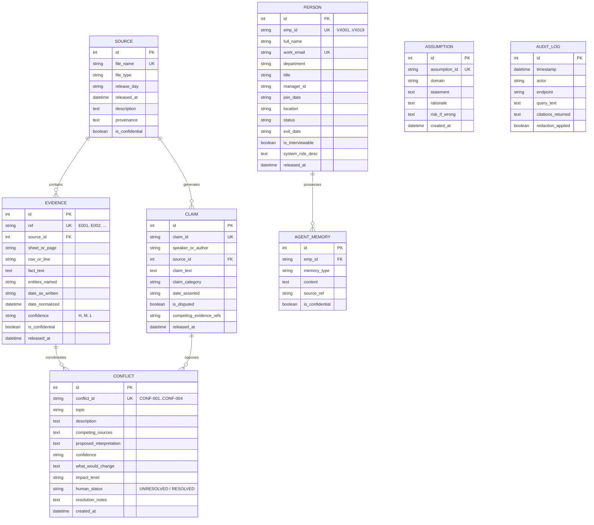

# Veloxa CXO Cockpit — Architecture & System Design
**Assessment Phase:** Individual Hackathon (Day 1 Release — Mon 16 Nov 2026 10:00 IST)  
**Author / Candidate:** Rivu Chattopadhyay  
**Repository:** https://github.com/rivu851/veloxa-cockpit-rivu-chattopadhyay  
**Submission Deadline:** Monday 16 Nov 2026 by 23:59 IST  

---

## 1. System Overview & Core Tenets

The **Veloxa CXO Cockpit** is an executive intelligence and governance platform designed for the Chief Executive Officer and senior leadership of Veloxa Technologies. It aggregates unstructured transcripts, board presentations, spreadsheets, emails, and financial ledgers into a grounded, zero-hallucination decision support system.

### Core Architectural Tenets
1. **Deterministic Grounding & Zero-Hallucination:** Every factual answer returned by the Cockpit must be backed by one or more immutable evidence citations (`E001`, `E002`, ...). The system refuses to answer queries that lack primary source evidence in the active data room.
2. **Strict Salary Privacy Enforcement:** Individual employee compensation data is protected at the API and service layer per CFO Meera Iyer's governance directive (`T2_CFO_Call`). Individual salaries are never returned to the CEO; only aggregated company-wide payroll disbursements are accessible.
3. **Temporal Partitioning & As-Of Consistency:** Facts and events carry dual timestamps (`effective_timestamp` for business reality and `released_at` for data room availability). The engine strictly prevents future release material from leaking into historical queries.
4. **Human-in-the-Loop Conflict Governance:** Discrepancies between executive verbal claims and audited board reports are explicitly recorded with competing evidence, confidence levels, and proposed interpretations, marked `UNRESOLVED` until confirmed by a human decision-maker.
5. **Interviewable Grounded AI Agents:** 14+ AI employee personas are grounded strictly in organizational records (`Employee_Master.xlsx`), operating within realistic role and knowledge boundaries.

---

## 2. High-Level Architecture Diagram

```mermaid
flowchart TD
    subgraph DataRoom ["Data Room Sources (Day 1 Release)"]
        D1["Employee_Master.xlsx (Keka HRMS)"]
        D2["GL_Export_Apr-Sep_2026.xlsx (Zoho Books)"]
        D3["Payroll_Register_Jan-Mar_2026.xlsx"]
        D4["Board Updates (Q1 & Q2 FY27)"]
        D5["Emails (01.eml, 02.eml, 03.eml)"]
        D6["Transcripts (T1 CEO Call, T2 CFO Call)"]
    end

    subgraph Ingestion ["Deterministic Ingestion & Normalization"]
        Parser["Deterministic Ingest Engine (ingest.py)"]
        PrivacyMask["Service-Layer Privacy Redactor (privacy.py)"]
    end

    subgraph Storage ["SQLite Relational Storage"]
        T_Source["sources"]
        T_Evidence["evidence (E001..E060)"]
        T_Claim["claims"]
        T_Person["people (VX001..VX019)"]
        T_Conflict["conflicts (CONF-001..CONF-004)"]
        T_Assumption["assumptions"]
        T_Memory["agent_memories"]
        T_Audit["audit_logs"]
    end

    subgraph ServiceLayer ["FastAPI Core Services (backend/app)"]
        QueryEngine["Query & Retrieval Engine (query_engine.py)"]
        TemporalFilter["Temporal 'As-Of' Filter"]
        AgentEngine["Grounded Agent Engine"]
        PrivacyEnforcer["Salary Privacy Enforcer"]
    end

    subgraph Presentation ["Next.js App Router (frontend/src)"]
        UI_Query["CEO Decision Query & Answer View"]
        UI_Evidence["Collapsible Evidence Drawer"]
        UI_Risks["Ranked Evidence-Backed Risks"]
        UI_Agents["14+ Grounded Employee Agents"]
        UI_Conflicts["Source Conflict & Human Review Table"]
    end

    DataRoom --> Parser
    Parser --> PrivacyMask
    PrivacyMask --> Storage
    Storage --> ServiceLayer
    ServiceLayer --> Presentation
```



---

## 3. Relational Database Schema

The persistence layer uses SQLite with SQLAlchemy ORM, implementing a normalized schema designed for temporal provenance, conflict tracking, and privacy protection.



---

## 4. Privacy & Redaction Architecture

### The Problem
In interview `T2_CFO_Call.docx`, CFO Meera Iyer issues an unequivocal governance rule:
> *"Individual salaries must never show up in anything Ananya sees, only totals."*

However, the data room includes `Payroll_Register_Jan-Mar_2026.xlsx`, which contains granular monthly gross, net, and deduction amounts for all 19 employees. Committing raw salary data to public GitHub or exposing it through the executive Cockpit violates both company policy and candidate assessment guidelines.

### Implementation
1. **Public Seed vs Private Data:**
   - Confidential individual compensation rows are never published in raw format.
   - Public seed fixtures store sanitized metadata (days in month, days payable, pro-ration status) while masking sensitive gross and net rupee figures.
2. **Service-Layer Privacy Interceptor (`backend/app/services/privacy.py`):**
   - The query engine intercepts any executive query matching individual salary patterns (e.g. *"What is Vikram's salary?"*, *"How much is Rahul paid?"*).
   - The system immediately returns an honest `REFUSAL`:
     ```json
     {
       "status": "REFUSAL",
       "answer": "REFUSAL: Policy restriction. Individual employee compensation details are confidential and restricted from executive cockpit queries per CFO governance directive (T2_CFO_Call). Only aggregated company-wide payroll totals may be reported.",
       "citations": [{"ref": "E027", "source_file": "T2_CFO_Call.docx"}]
     }
     ```
3. **Evidence Redaction:**
   - In `/api/evidence/{ref}`, any payroll register entry containing gross or net monetary amounts has those fields dynamically replaced with `[REDACTED_CONFIDENTIAL]`.
4. **Agent Role Boundaries:**
   - In `/api/agents/{id}/chat`, agents (including CFO Meera and payroll exec Fatima) strictly decline to disclose coworker compensation.

---

## 5. Temporal Filtering & As-Of Historical Queries

To support historical questions and prevent hindsight bias or future data leakage, all evidence items record:
- `date_normalized`: The business date when the event occurred.
- `released_at`: The exact release timestamp (e.g., `2026-11-16T10:00:00+05:30` for Day 1).

When a query specifies an `as_of` parameter:
$$\text{Visible Evidence} = \{ e \in \text{Evidence} \mid e.\text{released\_at} \le \text{as\_of}_{\text{timestamp}} \land e.\text{date\_normalized} \le \text{as\_of}_{\text{date}} \}$$

Queries referencing future hackathon days (e.g. Day 2, Day 3) or unreleased periods return a `REFUSAL: Temporal boundary violation`.

---

## 6. Ranked Evidence-Backed Risk Engine

The Cockpit identifies and ranks organizational risks based on cross-system evidence:

| Rank | Risk ID | Category | Severity | Primary Evidence | Core Issue & Recommended Mitigation |
|---|---|---|---|---|---|
| **1** | `RISK-001` | Engineering | **CRITICAL** | `E004`, `E008`, `E015`, `E026` | **Atlas v3 Slipped GA & Stability Debt:** Launch slipped from Sep 15 due to August reliability incident requiring external support (Patil Infra). Heavy key-person dependency on Priya Nair. *Mitigation: Technical hardening audit; lift backend freeze.* |
| **2** | `RISK-002` | Governance | **HIGH** | `E001`, `E006`, `E025`, `E027` | **Executive Financial Metric Disconnect:** 7x variance in ARR (Rs. 6.1 Cr board vs 42-45 Cr CEO) and 20x variance in monthly burn (Rs. 44 L board vs 2.2-2.5 L CFO). *Mitigation: Real-time board-linked financial dashboard.* |
| **3** | `RISK-003` | Operational | **HIGH** | `E005`, `E009`, `E014` | **Frozen Backend Engineering Commitments:** Veloxa committed to Board to add 2 backend engineers and paid Rs. 1.77 L advance to Cohere Recruiting, but froze hiring. *Mitigation: De-risk search fee forfeiture and prioritize Atlas hires.* |
| **4** | `RISK-004` | Financial | **HIGH** | `E003`, `E007`, `E009` | **Runway Compression & Capital Dependency:** Runway decreased from 14 to 13 months at Rs. 44 L/mo burn. Closing the investment round is urgent. *Mitigation: Establish contingency expense scenarios if round slips.* |
| **5** | `RISK-005` | Financial | **MEDIUM** | `E017`, `E018`, `E019`, `E023`, `E024` | **Payroll Controls Breakdown & Unreconciled Overpayment:** Absence of dual-authorization during Fatima's leave caused Rahul Verma to be paid full month for partial Feb; acknowledged but never reconciled. *Mitigation: Automated Keka pro-ration rules.* |

---

## 7. Deterministic Verification & One-Command Deployment

The application is structured for deterministic evaluation and single-command local deployment on fresh clones.

### Verified Architecture Stack
- **Backend:** Python 3.14+, FastAPI, SQLAlchemy, SQLite, Pydantic v2, Pytest (25/25 automated tests passing).
- **Frontend:** Next.js 14.2 (App Router), React 18, TypeScript, Tailwind CSS, Lucide React (Static & SSR production build verified).
- **LLM Mode:** Deterministic No-Key rule engine is the default. Optional Gemini API integration via standard environment configuration.

### Fresh Clone One-Command Run
```bash
# Terminal 1: Backend
cd backend && python -m venv .venv && .venv/Scripts/pip install -r requirements.txt && .venv/Scripts/python -m uvicorn backend.app.main:app --port 8000

# Terminal 2: Frontend
cd frontend && npm install && npm run dev
```

Single PowerShell orchestration script (`run_all.ps1`) is provided at repository root to launch both services simultaneously.
